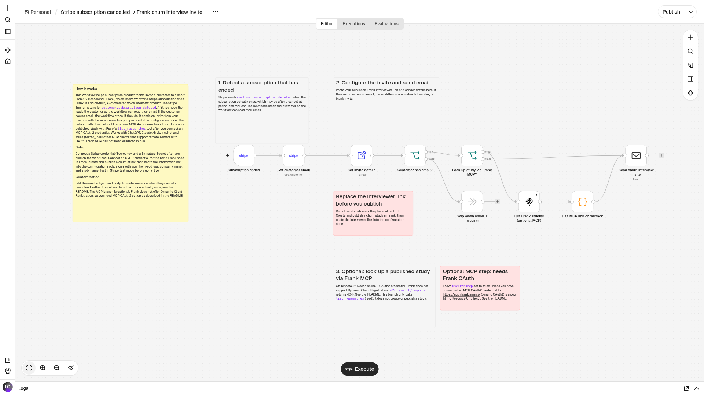
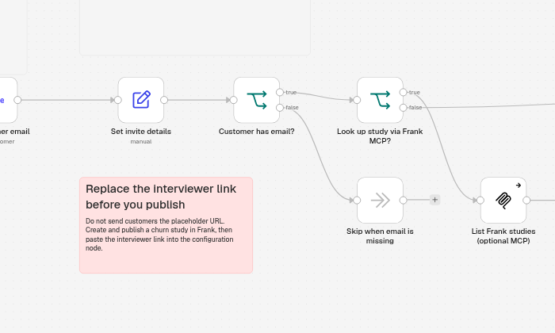
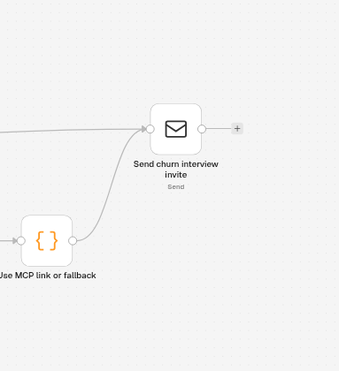
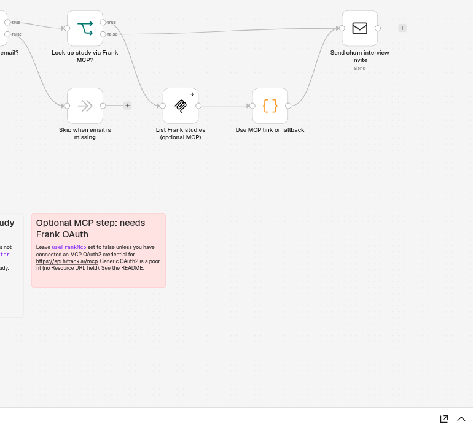

# How to send a Frank churn interview invite from n8n

This page publishes an n8n workflow template that emails a customer a Frank AI Researcher (Frank) voice-interview invite after their Stripe subscription ends.

Frank is an AI user researcher that runs short voice interviews. Works with ChatGPT, Claude, Grok and Muse, plus other MCP clients that support remote servers with OAuth. This template does not treat n8n as a validated Frank MCP client.

Import file: [workflow.json](workflow.json)

Learn more about Frank: [https://hifrank.ai/?utm_source=n8n&utm_medium=template&utm_campaign=churn-template](https://hifrank.ai/?utm_source=n8n&utm_medium=template&utm_campaign=churn-template)

Frank's Free plan includes 225 signup credits plus 60 voice minutes a month, with no card required.

## Screenshots

The canvas below was imported into a local n8n 2.49.6 instance. No Stripe, email, or Frank credentials were connected, and the workflow was not executed.

## What it does

1. The **Stripe Trigger** listens for `customer.subscription.deleted`. Stripe sends this event when a subscription actually ends, not always at the moment a customer clicks cancel. If the customer cancelled at period end, the event arrives when the period ends.
2. The **Stripe** node loads the customer record (`Customer → Get`) so the workflow can read their email and name. The subscription event usually contains only a customer ID, not an email address.
3. **Set invite details** holds the values you change: interviewer link, from-address, company and product names, study name, email subject, and whether to use the optional Frank MCP lookup.
4. If the customer has no email, the workflow stops.
5. By default, the **Send Email** node (SMTP) sends the invite with the interviewer link you pasted.
6. An **optional** branch can call Frank's remote MCP server at `https://api.hifrank.ai/mcp` and use the `list_researches` tool to look up a published study's interviewer link. That branch is off until you set `useFrankMcp` to true and connect an MCP OAuth2 credential. It only reads existing studies. It does not create or publish a study, and it does not spend Frank credits. Frank MCP OAuth is not a drop-in setup in n8n today; see [Frank MCP and OAuth in n8n](#frank-mcp-and-oauth-in-n8n).

## Setup steps

1. Import [workflow.json](workflow.json) into n8n (workflow menu → Import from File, or paste the JSON).
2. Create a Stripe credential with a Secret key (`sk_test_…` for test mode, `sk_live_…` for live mode). Do not use a publishable key. See [Stripe credentials](https://docs.n8n.io/integrations/builtin/credentials/stripe/).
3. Attach that credential to **Subscription ended** and **Get customer email**.
4. Create an SMTP credential and attach it to **Send churn interview invite**. You can use your provider's SMTP server, or Gmail SMTP with an app password. If you prefer the Gmail node instead, see [Customization](#customization).
5. In your Frank account, create a churn / cancellation study, publish it, and copy the interviewer link that Frank gives you for a published study. A draft has no interviewer link until it is published. This template does not publish studies for you.
6. Open **Set invite details** and replace every placeholder:
   - `interviewLink`: your published Frank interviewer link (required before you go live).
   - `fromEmail`: a sender your SMTP account is allowed to use, for example `Research team <research@example.com>`.
   - `companyName` and `productName`.
   - `studyName`: used only if you turn on the optional MCP lookup.
   - `emailSubject` if you want a different subject.
   - Leave `useFrankMcp` set to `false` unless you have completed the MCP OAuth setup below.
7. Publish the workflow once so n8n can create the Stripe webhook endpoint. Then, in the Stripe Dashboard, open the endpoint n8n created (description starts with `Created by n8n for workflow ID:`), copy the signing secret (`whsec_…`), and paste it into the Stripe credential as the Signature Secret. n8n can verify signatures from n8n 2.25.7 and 2.26.2. See [Verify incoming requests](https://docs.n8n.io/integrations/builtin/credentials/stripe/).
8. Test in Stripe test mode: end a test subscription, confirm the workflow runs, and confirm the invite arrives. Check the no-email path by using a customer without an email. Then switch to live keys only when the test looks right.

## Credential setup

| Credential | Used by | What to enter |
| --- | --- | --- |
| Stripe API | Stripe Trigger, Stripe | Secret key. Signature Secret after the webhook exists. |
| SMTP | Send Email | Host, port, user, and password or app password for your mailbox. |
| MCP OAuth2 API (optional) | MCP Client | See below. Leave disconnected if `useFrankMcp` is false. |

The exported JSON contains only placeholder credential IDs and names. It contains no API keys, tokens, or real account IDs.

## Frank MCP and OAuth in n8n

The default path does not call Frank over MCP. Use it: create and publish the churn study in Frank, paste the interviewer link, and send the invite by SMTP.

The optional MCP branch needs a working Frank OAuth client in n8n. Frank does not support Dynamic Client Registration (`POST /oauth/register` returns 404). n8n's MCP OAuth2 credential can use a Client ID Metadata Document from n8n 2.47.0 if CIMD is enabled on a publicly reachable HTTPS instance, or a pre-registered client. Generic OAuth2 is a poor fit because it has no Resource URL field, and Frank's resource is `https://api.hifrank.ai/mcp`.

If you turn `useFrankMcp` on and the MCP call fails, the workflow falls back to the pasted interviewer link. If you do connect MCP OAuth2, request only the read scopes you need (`research:read` is enough for `list_researches`).

There is no separate "create invite" tool. The shareable invite is the interviewer link on a published study, which `list_researches` returns.

## Customization

- **Email copy.** Edit the subject in **Set invite details** and the body in **Send churn interview invite**. Keep the interviewer link in the message.
- **Gmail instead of SMTP.** Add a Gmail node (`n8n-nodes-base.gmail`, Message → Send) with a Google credential, map the same from/to/subject/body fields, and reconnect it in place of the Send Email node. See [Gmail docs](https://docs.n8n.io/integrations/builtin/app-nodes/n8n-nodes-base.gmail/).
- **Invite at cancel-at-period-end, not at period end.** `customer.subscription.deleted` fires when the subscription ends. If you want to invite the customer at the moment they request cancellation, add or switch to `customer.subscription.updated` and keep only events where the subscription is set to cancel at period end (for example `cancel_at_period_end` is true). Test this path carefully so you do not send two invites.
- **Duplicate sends.** Stripe may retry a webhook. This template does not de-duplicate on event ID.

## Limitations

- The workflow was imported into a throwaway local n8n 2.49.6 instance. All 15 nodes loaded with their documented types and versions, with connections intact and no unknown-node errors. It was not run against live Stripe or Frank accounts, and no credentials were connected.
- Frank MCP has not been validated in n8n.
- The placeholder interviewer link must be replaced before you publish the workflow. Do not send customers the placeholder URL, and do not use the Frank homepage as the customer invite link.
- Customers without an email address are skipped.

## Related pages

- [Churn interviews](../../churn-interviews.md)
- [Interview churned users quickly](../../interview-churned-users-quickly.md)
- [How to run churn interviews with ChatGPT and Frank MCP](../../how-to-run-churn-interviews-with-chatgpt-and-frank-mcp.md)
- [MCP server for customer interviews](../../mcp-server-for-customer-interviews.md)
