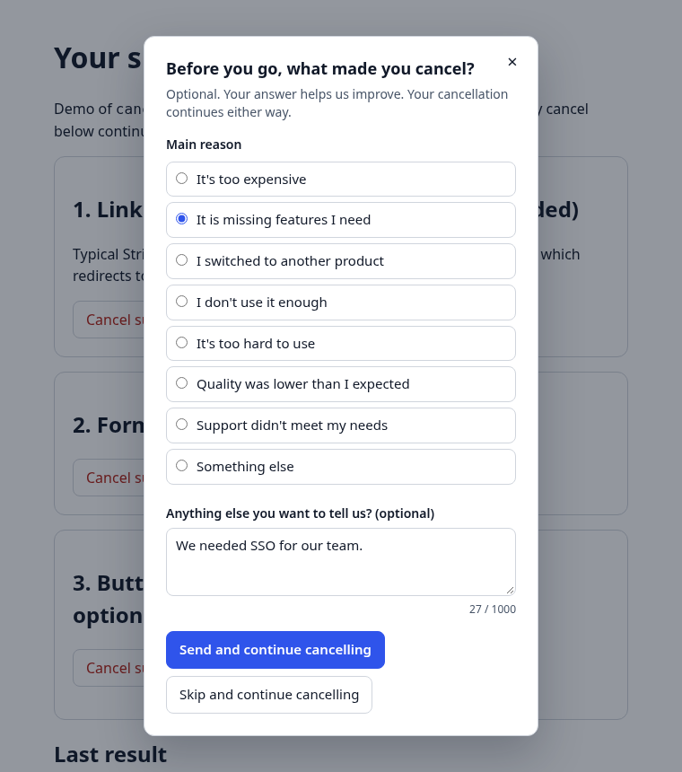

# cancel-reasons

A tiny, dependency-free "Before you go, what made you cancel?" step for SaaS cancel pages. Works with Stripe and Paddle. It never blocks the cancel.

- About 4 KB gzipped, no dependencies, ESM, CommonJS and a script-tag build, TypeScript types included.
- Accessible: native modal `<dialog>`, labelled radio group, keyboard and screen reader friendly, focus returns to your button. Tested with axe-core.
- Honest by design: answering is optional, "Skip and continue cancelling" is always one click, and the cancel continues even if your callback or webhook is slow or fails.
- Styles are isolated in a shadow root, so it won't clash with your CSS (and your CSS won't break it).



**Live demo and copy-paste snippets:** https://nar-vardanyan.github.io/frank-mcp/tools/churn-interview-widget/

## Quick start (script tag via jsDelivr)

```html
<a href="/billing/cancel" data-cancel-reasons data-cancel-reasons-webhook="/api/cancel-reason">
  Cancel subscription
</a>

<script src="https://cdn.jsdelivr.net/gh/nar-vardanyan/frank-mcp@ededde699aa793ec3a352aece7d582ad077775da/widgets/churn-interview/dist/cancel-reasons.min.js"></script>
```

That's it. When the customer clicks the link, the step opens. After they answer or skip, the answer is POSTed as JSON to `/api/cancel-reason` and the link continues to `/billing/cancel`.

## With JavaScript

```html
<button id="cancel">Cancel subscription</button>

<script type="module">
  import { attach } from 'https://cdn.jsdelivr.net/gh/nar-vardanyan/frank-mcp@ededde699aa793ec3a352aece7d582ad077775da/widgets/churn-interview/dist/cancel-reasons.min.mjs';

  attach('#cancel', {
    metadata: { plan: 'pro' },
    onSubmit: (result) => fetch('/api/cancel-reason', {
      method: 'POST',
      headers: { 'Content-Type': 'application/json' },
      body: JSON.stringify(result),
    }),
  });

  // Your existing cancel handler keeps working. It runs after the step.
  document.getElementById('cancel').addEventListener('click', cancelSubscription);
</script>
```

The package is not on npm yet. Load it from jsDelivr as above, or copy `dist/` into your app.

## How it works

`attach(target, options)` listens for clicks on your cancel link or button. On click it opens the step. Then:

| Customer does | What happens |
| --- | --- |
| Picks a reason and/or writes a comment, clicks "Send and continue cancelling" | Result is sent, then the original click continues (link navigates, form submits, your handlers run). |
| Clicks "Skip and continue cancelling" | Result with `skipped: true` is sent, then the original click continues. |
| Presses Escape or the close button | Dialog closes, nothing is sent, they stay on the page. Same as not clicking cancel. |

Before the cancel continues, the widget waits for `onSubmit` and the webhook for at most `callbackTimeoutMs` (default 1500 ms). If either is slow, throws, or fails, the cancel continues anyway. If the dialog itself can't render, the cancel continues immediately.

## The result

```json
{
  "reason": "too_expensive",
  "reasonLabel": "It's too expensive",
  "comment": "Budget cut this quarter",
  "skipped": false,
  "timestamp": "2026-11-27T10:00:00.000Z",
  "page": "https://app.example.com/settings/billing",
  "metadata": { "plan": "pro" }
}
```

You get it three ways, use any of them:

1. `onSubmit(result)` callback.
2. A `cancelreasons:submit` DOM event on the clicked element (bubbles to `document`), with the result in `event.detail`.
3. `webhookUrl`: a JSON `POST` (sent with `keepalive`, so it survives the page navigating away). Prefer a same-origin URL; a cross-origin one needs CORS. Don't put secrets in `webhookHeaders`, they are visible in the browser.

## Default reasons

The default values match Stripe's `cancellation_details.feedback` values, so a Stripe backend can pass them straight through:

| value | label |
| --- | --- |
| `too_expensive` | It's too expensive |
| `missing_features` | It is missing features I need |
| `switched_service` | I switched to another product |
| `unused` | I don't use it enough |
| `too_complex` | It's too hard to use |
| `low_quality` | Quality was lower than I expected |
| `customer_service` | Support didn't meet my needs |
| `other` | Something else |

Pass `reasons: [{ value, label }, ...]` to use your own.

## Options

| Option | Default | |
| --- | --- | --- |
| `reasons` | see above | Array of `{ value, label }`. |
| `text` | English copy | Override any of `title`, `description`, `reasonsLegend`, `commentLabel`, `commentPlaceholder`, `submitLabel`, `skipLabel`, `closeLabel`, `interviewLabel`. Use this for translations. |
| `onSubmit` | `null` | `(result) => void \| Promise`. Awaited up to `callbackTimeoutMs`. |
| `onContinue` | `null` | `(result, trigger) => void`. Replaces "replay the original click". Use it to call your own cancel API. |
| `onDismiss` | `null` | Called when the customer closes the dialog without cancelling. |
| `webhookUrl` | `null` | URL that receives the result as JSON. |
| `webhookHeaders` | `null` | Extra headers for the webhook request. |
| `metadata` | `null` | Your own data, echoed in the result. |
| `callbackTimeoutMs` | `1500` | Max wait for `onSubmit` and the webhook. |
| `maxCommentLength` | `1000` | Comment character limit. |
| `interviewLink` | `null` (off) | `{ url, label? }`. Adds a link under the form, see below. |
| `theme` | `null` | `{ accent, accentText, background, text, muted, border, radius, fontFamily }`. |
| `container` | `document.body` | Where the dialog mounts. |

Data attributes for the no-JavaScript setup: `data-cancel-reasons`, `data-cancel-reasons-webhook`, `data-cancel-reasons-interview-url`, `data-cancel-reasons-title`.

Other exports: `open(options)` shows the step and resolves with the result (or `null` if closed), `report(result, options)` runs the callback, event and webhook, `autoInit(root)` attaches to `[data-cancel-reasons]` elements (the script-tag build runs it on page load).

## Stripe and Paddle guides

- [Stripe](docs/stripe.md): Customer Portal cancel flow redirect, and custom cancel flows that call the Stripe API from your backend.
- [Paddle Billing](docs/paddle.md): cancel from your backend with the Paddle API, Paddle's hosted cancel page, and a note on Paddle Retain.

The widget never needs a Stripe or Paddle key. Keep secret keys on your server.

## Optional: invite a short voice chat

Off by default. If you run customer interviews, you can add one line under the form that opens your own interview link in a new tab:

```js
attach('#cancel', {
  interviewLink: { url: 'https://your-interview-link.example' },
});
```

The default label is "Want to tell us more in a 5-minute voice chat?". Only `http` and `https` URLs are accepted. The link never replaces or delays the cancel.

If you need a tool for that link: Frank is an AI user researcher that runs short voice interviews. [hifrank.ai](https://hifrank.ai/?utm_source=github&utm_medium=oss&utm_campaign=churn-widget)

## Browser support

Uses `<dialog>`, shadow DOM and `fetch` with `keepalive`, which current Chrome, Edge, Firefox and Safari support. The automated tests run in headless Chrome. The builds target ES2019.

## Development

```sh
npm install
npm run build   # dist/: .mjs, .cjs, .min.js (script tag), .min.mjs, .d.ts
npm test        # builds, then runs headless Chrome tests (set CHROME_PATH if needed)
npm run demo    # http://127.0.0.1:8080/ , webhook POSTs are printed in the terminal
```

## Versions and CDN URLs

This widget lives in the `widgets/churn-interview/` folder of [nar-vardanyan/frank-mcp](https://github.com/nar-vardanyan/frank-mcp) and is served by jsDelivr straight from GitHub:

- Latest (follows `main`, jsDelivr may cache it for a while): `https://cdn.jsdelivr.net/gh/nar-vardanyan/frank-mcp@main/widgets/churn-interview/dist/cancel-reasons.min.js`
- Pinned (recommended for production): `https://cdn.jsdelivr.net/gh/nar-vardanyan/frank-mcp@ededde699aa793ec3a352aece7d582ad077775da/widgets/churn-interview/dist/cancel-reasons.min.js` (v0.1.0). The snippets above use this commit.

Files in `dist/`: `cancel-reasons.min.js` (script tag, `window.CancelReasons`), `cancel-reasons.min.mjs` and `cancel-reasons.mjs` (ES modules), `cancel-reasons.cjs` (CommonJS), `cancel-reasons.d.ts` (types).

## Maintainer notes: publishing as its own package later

Not done yet. If the widget moves to its own repo and npm:

1. Create the repo (for example `cancel-reasons`) and copy this folder's contents to its root. Keep the history note in CHANGELOG.
2. In `package.json`: remove `"private": true`, set `repository.url` to the new repo and drop `repository.directory`, set `homepage` and `bugs`.
3. `npm ci && npm test`, then `npm publish --access public` from an npm account with 2FA. Check the name is still free first: `npm view cancel-reasons` should return 404.
4. Run `node scripts/set-cdn.mjs npm` to switch the README and guides to `https://cdn.jsdelivr.net/npm/cancel-reasons@<version>/dist/...`, and restore the `npm install cancel-reasons` line.
5. Tag the release (`v0.1.0`) and add a GitHub release.

## License

MIT. See [LICENSE](LICENSE). The rest of the frank-mcp repository is also MIT licensed.
